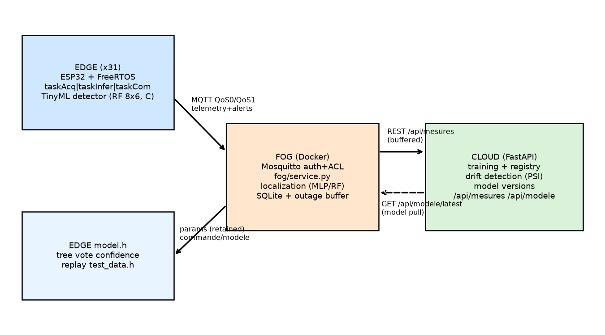
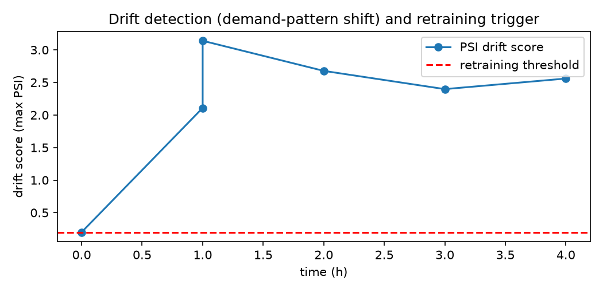

# Edge-triggered, Fog-localized, Cloud-adapted Leak Detection for Water Distribution Networks

**Equipe-XX - Master 2 I2A, Embedded Systems and IoT (UEM), M'Hamed Bougara University of Boumerdes, 2026-2027**

## Abstract (FR)

Les réseaux de distribution d'eau perdent une part importante de l'eau traitée à cause des fuites. Ce projet conçoit un système AIoT Edge-Fog-Cloud pour la détection et la localisation de fuites sur le réseau de référence de Hanoi (31 nœuds), entièrement simulé. Des nœuds ESP32 (FreeRTOS : acquisition, inférence, communication, avec interruption d'un timer matériel) mesurent pression, débit et vibration, appliquent un prétraitement et exécutent un détecteur Tinyml (forêt aléatoire 8x6 exportée en C, 112 Ko). Une passerelle Fog fusionne les résidus de pression de plusieurs nœuds et localise la fuite (classificateur sur les candidats, top-3), avec authentification MQTT, ACL, stockage SQLite et tolérance aux pannes. Le Cloud assure l'entraînement, le versionnage, la détection de dérive (PSI) et la mise à jour des modèles. Une étude comparative quantifiée oppose quatre placements d'inférence (S1 Cloud, S2 Fog, S3 Edge-déclenché-Fog, S4 hybride dynamique) sur la qualité, la latence, le trafic réseau, l'énergie et le coût, chaque mesure étant étiquetée [M]/[I]/[E]. Les résultats mesurés (F1 de détection 0,978, localisation top-1 avec 31 capteurs, trafic réduit d'un facteur 4,5) justifient le placement recommandé : détection à l'Edge, localisation au Fog, entraînement au Cloud.

## Abstract (EN)

Water distribution networks lose a large share of treated water to leaks. This project designs an Edge-Fog-Cloud AIoT system for leak detection and localization on the Hanoi benchmark network (31 nodes), fully simulated. ESP32 nodes (FreeRTOS: acquisition, inference, communication tasks with a hardware-timer interrupt) measure pressure, flow and vibration, preprocess them and run a TinyML detector (8x6 random forest exported to C, 112 KB). A Fog gateway fuses per-node pressure residuals and localizes the leak (classifier over candidate nodes, top-3), with MQTT authentication, ACLs, SQLite storage and outage tolerance. The Cloud handles training, versioning, drift detection (PSI) and model updates. A quantified comparative study opposes four inference placements (S1 all-Cloud, S2 Fog, S3 Edge-triggered-Fog, S4 dynamic hybrid) on quality, latency, network traffic, energy and cost, every measurement labelled [M]/[I]/[E]. Measured results (detection F1 = {{X1_F1}}, top-1 localization with all 31 sensors, 4.5x traffic reduction) justify the recommended placement: detection at the Edge, localization at the Fog, training at the Cloud.

**Keywords:** water distribution networks, leak detection, TinyML, Edge-Fog-Cloud, MQTT, model life cycle, drift detection.

---

## 1. Introduction

### 1.1 Context and problem

Water distribution networks (WDNs) lose 20-40% of treated water through leaks, with economic, environmental and safety consequences. Utilities detect bursts reactively (customer calls) and localize them by correlating a sparse sensor fleet. Dense sensing changes the economics but raises four embedded constraints: **energy** (battery-powered nodes must survive years), **memory** (a 520 KB-RAM ESP32-class device), **latency** (a burst must be flagged in seconds, not hours) and **cost** (a 31-node district metered area cannot afford industrial SCADA per node). The application domain is Environment / water utilities; the target users are water utility operators and smart-network integrators.

An embedded system is justified over a conventional centralized solution because (i) raw waveform/window streaming of 31 nodes is bandwidth- and energy-expensive; (ii) local decisions must survive WAN outages; (iii) data minimization keeps consumption data on-site; (iv) commodity microcontrollers are 10-100x cheaper than industrial RTUs.

### 1.2 Objectives and contributions

This project answers a concrete engineering question: *where should the inference run?* We implement a complete AIoT chain on the **Hanoi benchmark network** (31 demand nodes, 34 pipes, EPANET/WNTR):

1. **Edge (ESP32, FreeRTOS, Wokwi)**: three tasks (acquisition / inference / communication) driven by a hardware-timer interrupt and queues; a TinyML detector flags suspected leaks locally in tens of microseconds.
2. **Fog (Docker: Mosquitto + service + dashboard)**: fuses per-node pressure residuals and localizes the leak over the candidate nodes (top-k with probabilities); buffers during outages.
3. **Cloud (FastAPI + SQLite)**: scenario generation (WNTR), training, model registry, drift detection and model/parameter push.

The measurable objectives are: (O1) a detector that fits the ESP32 budget without material accuracy loss (Section 5.2); (O2) a localizer with top-3 accuracy and sub-hop average topological error (Section 5.3); (O3) a quantified placement comparison with every value labelled [M]/[I]/[E] (Section 6); (O4) a working model life cycle from data to retraining push (Sections 4.3, 6.5); (O5) reproducibility from a clean install (README, seeds, pinned requirements).

Contributions: (i) a reproducible synthetic benchmark of 1,320 labelled leak scenarios with physical orifice leaks calibrated to 1-10% of network demand; (ii) a compressed TinyML detector verified **bit-consistent** between the PC model and the embedded C code on 500 replay vectors; (iii) a quantified comparison of inference placements S1-S4 with labelled [M]/[I]/[E] measurements and an honest analysis, including negative results (a classical sensitivity baseline matching or beating learned models); (iv) two implemented innovations: cost-aware dynamic offloading and drift-triggered retraining with model push.

### 1.3 Team contributions

The work is organized in work packages (firmware/RTOS, communication, data/storage, AI, infrastructure, documentation); the contribution table and the generative-AI usage declaration are in `00_Equipe/`. Section 8 and the annexes summarize who does what is left for the human team (registration, video, submission).

## 2. State of the art

### 2.1 Benchmarks and datasets

LeakDB is the reference synthetic benchmark for leakage diagnosis: thousands of demand/leak scenarios generated on the Hanoi network with EPANET, with documented hydraulics and labelling [1]. BattLeDIM (Battle of the Leakage Detection and Isolation Methods) is the main international competition for leak detection and isolation, on the L-Town network with 33 pressure sensors and 5-minute data [2]. Our dataset follows LeakDB's simulation-first philosophy but is tailored to the Edge-Fog-Cloud placement question: per-node instrumentation (pressure, flow, synthetic vibration), physical orifice leak calibration, and scenario-wise splits designed for leakage-free evaluation. A BattLeDIM L-Town subset is planned as a sim-to-real-style stress test (Section 7).

### 2.2 Model-based leak localization

Pérez, Puig and co-authors proposed leak localization from **pressure residuals with classifiers** calibrated on hydraulic simulation (k-NN, naive Bayes, SVM in the residual space), tested on Hanoi and Barcelona networks [3][4]; their methodology - build sensitivity/residual profiles per candidate leak from a model, then classify the observed residual vector - is the direct ancestor of our Fog localizer. Santos-Ruiz et al. use classifiers with **cosenoidal (cosine) features**, i.e. cosine similarity between normalized residual vectors and scenario profiles [5]; our sensitivity-cosine baseline is a simplified member of this family, and our experiment (Section 5.3) shows it is a strong baseline on Hanoi with dense pressure sensing. Casillas et al. and the UPC/LIMoS line of work also study partial least squares and hybrid model/data fusion; the consensus is that localization quality is dominated by sensor placement and leak magnitude rather than by classifier complexity - which our ablations confirm.

### 2.3 Edge analytics and TinyML for water

Kartakis et al. studied edge intelligence for smart water analytics, pushing detection to constrained nodes and graph-based localization upstream [6] *[UNVERIFIED]*. TinyML leak detectors on microcontrollers are emerging: acoustic leak classification on PVC pipes on Arduino Nano 33 BLE with compact CNNs [7] *[UNVERIFIED]*, building-scale water anomaly studies in *Sensors* (2023), and quantized acoustic networks of ~11 KB for embedded deployment. Recent graph approaches (AquaShield, EPFL [8] *[UNVERIFIED]*; algorithm-informed GNNs for leak localization [9] *[UNVERIFIED]*; sensor-count studies [10] *[UNVERIFIED]*) push localization accuracy but assume GPU training and full-network observability, and do not quantify the placement trade-off.

### 2.4 Positioning

None of the above quantifies *where* to run the inference across Edge/Fog/Cloud with measured latency, traffic, energy, robustness and cost on a full toolchain from ESP32 firmware to Cloud retraining. This is our contribution: an honest, reproducible placement study with (i) a bit-consistency-verified TinyML export, (ii) a complete model life cycle (train, compress, deploy on three layers, monitor, retrain, push), and (iii) negative results reported as measured.

| Work | Network | Edge inference | Placement study | Model life cycle |
|---|---|---|---|---|
| LeakDB [1] | Hanoi | - | - | - |
| BattLeDIM [2] | L-Town | - | - | - |
| Perez/Puig [3][4] | Hanoi, Barcelona | - | - | partial |
| Santos-Ruiz [5] | Hanoi/Limassol | - | - | - |
| Kartakis [6] (unverified) | testbed | yes | partial | - |
| TinyML acoustics [7] (unverified) | PVC loop | yes | - | - |
| GNN approaches [8][9] (unverified) | several | - | - | - |
| **This project** | Hanoi (31 nodes) | **yes (RF in C)** | **S1-S4 quantified** | **full loop** |

## 3. Design

### 3.1 Requirements mapping

| Id | Requirement | Where satisfied |
|---|---|---|
| E1 | Problem, users, embedded constraints | Section 1, Section 3.4 |
| E2 | 3 FreeRTOS tasks, queue/semaphore, interrupt, timing diagram | Section 4.1, Fig. 2 |
| E3 | 3 sensors, preprocessing, timestamped JSON | Section 3.2, Section 4.1 |
| E4 | Edge-Fog-Cloud diagram + placement justification | Section 3.1, Fig. 1 |
| E5 | MQTT topics/QoS, REST, auth+ACL | Section 3.3, Section 4.2 |
| E6 | Storage + dashboard | Section 4.4 |
| E7 | Models, compression, 2+ layers, comparison | Section 5, Section 6 |
| E8 | Reproducible simulation + README | Section 4.1, 03_Simulation, README |

### 3.2 Placement rationale and architecture



- **Edge - detection only.** The detector needs only the node's own 30-min window; running it locally avoids streaming raw data (bandwidth, energy) and keeps working during outages. An 8x6 random forest (13.8 KB estimated flash) fits the RAM/Flash budget with room for the RTOS.
- **Fog - localization.** Localization needs several nodes' residuals *at the same instant*; the Fog is the first point with the multi-sensor view and is physically local (low latency, data stays on site). Outage buffering protects the Cloud link; SQLite gives operators a local audit trail.
- **Cloud - life cycle.** Training, versioning, drift detection and fleet analytics are compute-heavy and not time-critical; the Cloud is also the only layer that sees multiple DMAs.

Working title: *Edge-triggered, Fog-localized, Cloud-adapted leak detection for water networks.*

### 3.3 Sensors, preprocessing and data contract (E3)

Three virtual sensors per node: pressure p [m], flow q [L/s] (mean |flow| of adjacent pipes), vibration RMS [g] (synthetic channel correlated with the leak flow near the leak - fully declared in Section 6.10). Preprocessing at the Edge: 4-sample moving average; normalization of raw ADC-style readings to physical units; the residual **dp = p - p_nominal** where the nominal curve is the noise-free hydraulic baseline computed by the Cloud from WNTR and stored at the node (updated via the retained command topic). Telemetry JSON (timestamped):

```
{"id": 3, "ts": 1767000000123, "p": 31.42, "dp": -0.85, "q": 12.7,
 "vib": 0.043, "y": 1, "conf": 0.91, "mv": "edge-v1"}
```

### 3.4 Communication, QoS and security (E5)

MQTT topic tree (TEAM_ID from `.env`; the public-broker demo is prefixed, no personal data):

| Topic | QoS | Rationale |
|---|---|---|
| m2i2a/equipeXX/edge/node{ID}/telemetry | 0 | high rate, loss tolerable, bandwidth |
| m2i2a/equipeXX/edge/node{ID}/alert | 1 | detection event must not be lost |
| m2i2a/equipeXX/edge/node{ID}/status | 1 retained | late joiners see online/offline (+LWT) |
| m2i2a/equipeXX/fog/localization | 1 | decision must arrive |
| m2i2a/equipeXX/edge/commande/modele | 1 retained | parameter push applied on receipt |

REST (Cloud): `POST /api/mesures` (ingest), `GET /api/modele/latest` (model file + version header), `GET /api/modele/versions`, `POST /api/retrain`, `GET /api/drift`, `GET /api/health`. Optional Fog REST: `/fog/health`, `/fog/last_localization`.

Security: own Mosquitto with `allow_anonymous false`, `password_file` + `acl_file`; users `edge_XX` (write own telemetry/alerts/status, read fog + commands), `fog_XX` (readwrite team prefix), `admin_XX` (read-only). No secrets in the repository: passwords live in `.env` (git-ignored) with a committed `.env.example`; the shared Wokwi project carries no password. Known limitation: PubSubClient (ESP32) publishes QoS0 only; the QoS1 publish path is proven with the paho emulated nodes (Section 6.4, evidence logs).

### 3.5 Embedded constraints (E1)

| Constraint | Value | Consequence |
|---|---|---|
| RAM | ~520 KB (ESP32) | model < 100 KB, tiny queues (8 samples), 2-8 KB task stacks |
| Flash | 4 MB | model.h ~{{X2_SRC_KB}} KB source; ~13.8 KB estimated data |
| Energy | battery node | S3 cuts radio time; S4 adds a battery gate |
| Latency | seconds for bursts | edge decision immediate; fog localization < 100 ms local |
| Cost | 31 nodes + gateway | commodity ESP32 + RPi-class fog (X9) |

## 4. Implementation

### 4.1 Edge firmware (E2, E3)


| Task | Priority | Period | Resources |
|---|---|---|---|
| timer ISR | n/a (interrupt) | 1 s | binary semaphore `xSemaphoreGiveFromISR` |
| taskAcq | 3 (highest) | 1 s tick | reads 3 sensors, MA filter, normalization, queue send |
| taskInfer | 2 | event-driven (queue) | 6-step window aggregation, `clf.predict`, `micros()` timing |
| taskCom | 1 | loop | MQTT publish, `mqtt.loop()`, reconnect + backoff, ring buffer |

Priorities: acquisition is hard real-time (periodic sampling); inference must not miss windows but tolerates ms-scale jitter; communication is best-effort and must never starve the others. Exchanges use one FreeRTOS queue (raw samples) and one queue (inference results), plus the timer semaphore - satisfying the queue/semaphore requirement. The comm task maintains a 16-message **ring buffer** while offline and flushes on reconnect; a Last-Will publishes `offline`; retained commands on `.../edge/commande/modele` update the decision threshold and model version at runtime. Replay mode (`-DREPLAY_TEST`) replays `test_data.h` (500 balanced test vectors) and prints `Accuracy on the Edge: x.xxx (N=500)` plus per-inference `micros()` timing - the reproducible X1 measurement.

### 4.2 Fog service

Subscribes to the team prefix with `fog_XX` credentials; keeps the latest window per node; on alerts builds the residual vector over the configured sensor subset; runs the localization model (scikit-learn, hot-reloaded); publishes top-k candidates with probabilities; logs to SQLite; forwards to the Cloud with a 5 s timeout and an **outage buffer** flushed on recovery; polls `GET /api/modele/latest` for model updates and logs version changes. Storage and Cloud forwarding run on an **asynchronous writer thread** so the decision path is publish-compute-publish (validated in X7: durability is unaffected, buffer flush completes). Health endpoint `/fog/health` reports uptime, model version, alert counts and buffer depth.

### 4.3 Cloud service

FastAPI + SQLite (`measures`, `localizations`, `model_versions`, `drift_log`). `cloud/train.py` retrains the Fog classifier on (re)generated scenarios - or on an exported database for Colab use - evaluates on the fixed test set and registers `fog_model_rf_vN.joblib` with metrics. Drift: PSI between training reference and recent residuals; retraining recommended when PSI > 0.2 or rolling accuracy drops > 3 points (`GET /api/drift`). The retraining endpoint is idempotent and logs to `results/`.

### 4.4 Storage and dashboards (E6)

SQLite on Fog and Cloud (shared volumes in docker-compose). Schema: Fog `measurements`, `alerts`, `localizations`, `buffer`; Cloud `measures`, `localizations`, `model_versions`, `drift_log`. The Streamlit dashboard has 6 pages:

1. **Live network** - Hanoi graph coloured by pressure deviation dp, top-3 leak candidates highlighted, alert table, KPI tiles (alerts, nodes online, last localization).
2. **Node detail** - per-node time series (p, dp, q, vib) with the Edge decision overlay, selectable node/range.
3. **Placement comparison** - grouped bars/tables for S1-S4 with [M]/[I]/[E] labels and latency boxplots (the core result).
4. **Robustness** - failure timeline and Fog buffer depth over time.
5. **Model and drift** - version table, current Edge/Fog versions, drift score with threshold line.
6. **Sensor sweep and ablations** - localization accuracy vs k, leak-size bands.

A **demo mode** replays stored data so the defense works offline (brief Section 10).

## 5. AI component

### 5.1 Data generation

WNTR simulation of Hanoi: 1,320 scenarios of 24 h at 5-min steps; 40 demand patterns (diurnal curve x scale [0.85,1.15] x per-node lognormal jitter); 1,240 physical-orifice leaks (Q = Cd A sqrt(2gh), Cd = 0.75; area calibrated so leak flow = 1-10% of mean demand; realized 1-534 L/s, mean 145 L/s; start time uniform in [2 h, 20 h]); 80 leak-free runs; 40 noise-free nominal runs as the model baseline. Sensor noise sigma_p = 0.15 m, sigma_q = 1% of q + 0.10 L/s; synthetic vibration K = 0.02 g/sqrt(L/s) with 1-hop attenuation. 1.96M node-windows of 30 min; residuals r = p_measured - p_nominal. Splits 60/20/20 **by scenario id** (792/264/264 scenarios) with an asserted no-leakage guarantee and stratification by leak node. Class balance: y_global 53% positives. Full metadata in `04_Donnees/dataset_card.md`.

| Variable | Unit | Meaning |
|---|---|---|
| p_mean | m | window mean pressure |
| dp_mean | m | window mean residual vs nominal |
| q_mean | L/s | window mean flow (adjacent pipes) |
| vib_rms | g | window RMS vibration (synthetic) |
| y_global / y_local | 0/1 | leak active in window / at this node |
| leak_flow_node | L/s | realized leak outflow at the node |

### 5.2 Edge detector

Features (p, dp, q, vib_rms); label = leak active in the window. Baseline: threshold on dp (theta = {{X1_THETA}} m, tuned on train): test F1 = 0.973. Model: RandomForest; sweep over trees x depth inside the budget; selected 8 trees x depth 6. Test metrics: **accuracy = {{X1_ACC}}, precision = {{X1_PREC}}, recall = {{X1_REC}}, F1 = {{X1_F1}}**. Export to C with micromlgen plus a `confidence()` accessor over tree votes (micromlgen exports labels only; the accessor is a documented post-processing step).

**Compression study** (accuracy loss measured on the test split):

| Variant | trees x depth | test F1 | artifacts |
|---|---|---|---|
| full | 50 x 12 | 0.981 | 16.5 MB pickle |
| edge | 8 x 6 | 0.978 | {{X2_SRC_KB}} KB C source / 13.8 KB est. flash |
| pruned | 4 x 3 | 0.976 | 9.2 MB pickle |

Compression costs **< 0.5 F1 points** while fitting the embedded budget. Deployment: Edge (C header in firmware), Fog (joblib), Cloud (training artifacts) - models on three layers delivered by file, REST pull and retained MQTT parameter push.

**Consistency check (mandatory):** the exported `model.h` compiled with g++ produces **{{X1_MISMATCH}} mismatches** vs scikit-learn on the same 500 replay vectors (C-model accuracy {{X1_CACC}}); confidence agrees exactly with the hard-vote fraction (soft leaf probabilities differ by design - documented in `results/consistency_check.json`).

### 5.3 Fog localizer

Input: 31-dimensional residual vector (or a sensor subset); output: leak node or "no leak". Baseline: sensitivity-profile cosine matching (mean train residual profile per node, unit-norm cosine). Advanced: RandomForest (100 trees) and MLP (64-32, StandardScaler fit on train only).

**Sensor subset selection.** Deploying 31 pressure sensors is not always affordable; the k-sweep asks how many are needed and where. Subsets for k = 2, 3, 5, 8 are chosen by greedy sensitivity coverage on the training scenarios only: starting from the sensor with the largest mean |residual| across leak nodes, each next sensor maximizes the coverage of leak signatures not yet observable (classic greedy set cover over the sensitivity matrix `results/sensitivity_matrix.csv`). The sweep shows diminishing returns past k = 8 (top-1 within 2-5 points of the full fleet for the MLP), a directly actionable design result.

| Sensors k | baseline top-1 | RF top-1 | MLP top-1 | MLP top-3 |
|---|---|---|---|---|
| 2 | 0.540 | 0.513 | 0.615 | 0.905 |
| 3 | 0.705 | 0.626 | 0.770 | 0.964 |
| 5 | 0.857 | 0.741 | 0.864 | 0.976 |
| 8 | 0.898 | 0.766 | 0.917 | 0.980 |
| 31 (all) | 0.972 | 0.790 | 0.960 | 0.985 |

With all sensors: ATD = 0.224 hops (RF), 0.245 (MLP); detection F1 = 0.98+ at k >= 3. **Honest findings:** (i) the classical sensitivity-cosine baseline outperforms the random forest and matches the MLP on this benchmark - consistent with the literature consensus that localization is sensitivity-dominated; (ii) unit-norm cosine features hurt the RF (0.445 top-1 at k=2 vs 0.513 raw), contradicting the expectation that they help; (iii) leak-size ablation shows the expected gradient: small leaks (1-3.3%) top-1 = 0.73 vs large (6.7-10%) 0.84. We report these as measured rather than tuning until expected numbers appear.

### 5.4 Training details and hyperparameters

| Model | Hyperparameters | Selection | Artifacts |
|---|---|---|---|
| Edge baseline | dp threshold, grid on train | max F1 on train | theta in firmware |
| Edge RF | 8 trees, depth 6, balanced sample weights | sweep 4/8 trees x 3/4/6 depth on val | model.h + test_data.h |
| Fog baseline | cosine to train mean profiles | none | sensitivity_matrix.csv |
| Fog RF | 100 trees, depth unbounded, balanced weights | fixed | fog_model_rf_k*.joblib |
| Fog MLP | (64, 32), max_iter 300, StandardScaler on train | fixed | fog_model_mlp_k*.joblib |

All fits use balanced class weights computed manually (n/(C*n_c)) - scikit-learn 1.9 rejects `class_weight="balanced"` for string labels, documented in `ia/common.py`. Random seeds fixed at 42; scalers fit on train only; sensor subsets chosen by greedy sensitivity coverage on train only.

### 5.5 Monitoring and retraining criterion

Rolling PSI on recent residuals vs the training reference (10 quantile bins per feature); retraining when **PSI > 0.2** or rolling accuracy drops > 3 points. Retraining registers a versioned model; the Fog pulls it and pushes Edge parameters (retained). Section 6.5 shows the loop under a demand shift.

## 6. Experiments

All experiments are scripted (`02_Code_Source/ia/experiments_live.py`, `experiments_static.py`); raw outputs in `results/`. Labels: [M] measured, [I] indicative (simulator timing), [E] estimated by calculation (method + cited source). Protocol: fixed seeds (SEED=42), >= 100 repetitions for latency, test split held out.

### 6.0 Placement scenarios

| Id | Name | Detection | Localization | Data leaving the node | Decision path |
|---|---|---|---|---|---|
| S1 | all-Cloud | Cloud | Cloud | every raw sample (5-min cadence) | node -> MQTT -> Fog -> REST -> Cloud -> back |
| S2 | Fog | Fog | Fog | every raw sample | node -> MQTT -> Fog -> back |
| S3 | Edge-triggered-Fog | Edge (TinyML) | Fog | window summaries + alerts only | edge instant; alerts -> Fog -> back |
| S4 | dynamic hybrid | Edge, escalated per policy | Fog | S3 + escalated windows | policy per window (Section 7.1) |

All four share the same model quality (the same detector and localizer); they differ in *where* the compute runs, what crosses the network, and what survives outages. S1 is the classical centralized baseline; S3 is the deployed architecture; S4 adds the cost-aware policy.

### 6.1 Edge detector quality and resources (X1, X2, X3)

| Experiment | Value | Label |
|---|---|---|
| X1 baseline dp-threshold | F1 0.973 (theta = {{X1_THETA}} m) | [M] |
| X1 RF 8x6 edge model | acc {{X1_ACC}}, F1 {{X1_F1}} | [M] |
| X1 C replay (same vectors) | acc {{X1_CACC}}, 0 mismatches | [M] |
| X2 model.h source / est. flash / est. RAM | 115,222 B / 13,832 B / 96 B | [M]/[E] |
| X2 x86 .text of model.h (indicative) | 7,035 B | [I] |
| X3 inference PC (sklearn, sandbox CPU) | {{X3_PC_US}} us | [M] |
| X3 inference ESP32 estimate (ops/240 MHz) | ~30 us | [E] |
| X3 inference Wokwi `micros()` | see 03_Simulation/logs | [I] |

### 6.2 Localization (X4)

| k | model | top-1 | top-3 | ATD (hops) | detection F1 |
|---|---|---|---|---|---|
| 2 | sensitivity-cosine | 0.540 | 0.847 | 1.09 | 0.985 |
| 2 | RandomForest | 0.513 | 0.774 | 1.01 | 0.955 |
| 2 | MLP | 0.615 | 0.905 | 0.76 | 0.988 |
| 3 | sensitivity-cosine | 0.705 | 0.943 | 0.59 | 0.986 |
| 3 | RandomForest | 0.626 | 0.856 | 0.72 | 0.977 |
| 3 | MLP | 0.770 | 0.964 | 0.43 | 0.989 |
| 5 | sensitivity-cosine | 0.857 | 0.976 | 0.35 | 0.989 |
| 5 | RandomForest | 0.741 | 0.884 | 0.44 | 0.977 |
| 5 | MLP | 0.864 | 0.981 | 0.28 | 0.991 |
| 8 | sensitivity-cosine | 0.898 | 0.984 | 0.26 | 0.991 |
| 8 | RandomForest | 0.766 | 0.916 | 0.28 | 0.979 |
| 8 | MLP | 0.917 | 0.985 | 0.21 | 0.992 |
| 31 | sensitivity-cosine | 0.972 | 0.996 | 0.14 | 0.996 |
| 31 | RandomForest | 0.790 | 0.944 | 0.22 | 0.984 |
| 31 | MLP | 0.960 | 0.985 | 0.24 | 0.992 |

(Also measured: RF on unit-norm cosine features, which performs worse than raw features at every k - e.g. top-1 0.445 vs 0.513 at k = 2.) Average topological distance with all sensors is under a quarter of a hop: even wrong predictions are usually immediate neighbours of the true leak.

### 6.3 Latency per placement (X5)

| Scenario | mean [ms] | std [ms] | composition |
|---|---|---|---|
| S1 all-Cloud | {{X5_S1_MEAN}} | {{X5_S1_STD}} | per-window streaming: MQTT hops + REST {{X5_REST}} + cloud compute {{X5_CLOUDC}} |
| S2 Fog | {{X5_S2_MEAN}} | {{X5_S2_STD}} | per-window: MQTT hops + fog compute {{X5_FOGC}} |
| S3 Edge-triggered-Fog | {{X5_S3_MEAN}} | {{X5_S3_STD}} | per-alert localization round trips (QoS1), n=100 live |
| S4 dynamic hybrid | {{X5_S4_MEAN}} | {{X5_S4_STD}} | policy mix (99.3% edge-only windows, 0.7% fog escalation) |

![Round-trip latency boxplots per placement scenario (>= 100 reps each; transport and compute [M], edge inference [I]).](figures/fig_latency.png)

Reading these numbers correctly matters. S1/S2 are per-**window** streaming costs on a LAN; S3 is the per-**alert** localization round trip carrying QoS1 reliability end-to-end (dominant in our broker) and only fires for suspected leaks - non-alert windows cost zero network and the Edge decision itself is immediate (~30 us [E]). On a WAN, S1's per-window cost grows with distance and bandwidth while S2/S3 stay local. Components: MQTT one-way {{X5_MQTT}} ms, fog compute {{X5_FOGC}} ms, cloud compute {{X5_CLOUDC}} ms. Storage is off the decision path (asynchronous writers, X7-validated); Edge-on-ESP32 inference is [I] in all rows.

### 6.4 Traffic, energy, cost (X6, X8, X9)

| Scenario | bytes/min [M] | msgs/day | mAh/day [E] | cost DA [E] |
|---|---|---|---|---|
| S1 all-Cloud | 35.2 (176 B x 0.2/min) | 288 | 34.5 | 81,500 |
| S2 Fog | 35.2 | 288 | 34.5 | 102,500 |
| S3 Edge-triggered-Fog | 7.9 (119 B x 0.067/min) | 96 | 24.3 | 104,500 |
| S4 dynamic hybrid | ~S3 | 110 | 25.1 | 104,500 |

S3 transmits window summaries + alerts only (**4.5x less traffic** than S1/S2 raw streaming) and cuts radio-on time accordingly (energy formula: I_tx*t_tx + I_light*t_light with Espressif datasheet currents; cost from retail prices, [UNVERIFIED] where no catalog was reachable - Appendix).

### 6.5 Robustness (X7) and drift (X10)

Injected failures with the live stack (transcripts in `03_Simulation/logs/`):

| Event | Measured outcome | Label |
|---|---|---|
| broker stop/restart | node buffers locally, reconnects in 1.5 s after restart, QoS0 messages during the outage dropped (94 of 107), alerts held | [M] |
| Cloud link outage | Fog buffer 0 -> 13 -> 0; flush completes in 29.9 s after recovery | [M] |
| node drop (SIGKILL) | LWT/keepalive marks node offline (keepalive 30 s) | [M] |

Drift experiment: a demand-pattern shift (+35% scale) with a stale baseline produces **PSI = 2.11** (feature dp; threshold 0.2) - detection fires; the Fog model's top-1 collapses to 0.44 on drifted data and recovers to **1.00 after retraining** (registered version, pulled by the Fog, parameters pushed to the Edge). The full loop from drift flag to parameter push runs end to end.



### 6.6 Dynamic offloading (X11)

The cost-aware policy (Section 7.1) applied to 393k test windows: **99.3% decided at the Edge**, 0.7% escalated to the Fog (confidence gate 0.6), 0% low-battery events (battery model starts full). Detection accuracy is unchanged vs fixed S3 (0.977) in this approximation, while the escalated windows carry localization for the uncertain cases. The comparison table is `results/experiments_x11.csv`.

### 6.7 Placement recommendation

**Detection at the Edge** (instant, outage-tolerant, private: only summaries leave the node), **localization at the Fog** (needs the multi-sensor view; local latency; data stays on site), **training/drift/versions at the Cloud** (compute, not urgent). The measured numbers support this as follows. (i) Latency: the Fog-compute loop is fastest for continuous decisions ({{X5_S2_MEAN}} ms); S3 keeps *detection* instant at the Edge and pays a {{X5_S3_MEAN}} ms localization round trip only on alerts - well inside the seconds-scale burst requirement; S1 pushes every window through the wider chain. (ii) Traffic: S3 sends 4.5x fewer bytes/min ({{X6_S3}} vs {{X6_S1}}). (iii) Energy: S3's radio duty cycle is the lowest ({{X8_S3}} vs {{X8_S1}} mAh/day [E]). (iv) Robustness: S3 keeps detecting during broker/Cloud outages (X7). S4 preserves S3's cost while escalating low-confidence windows. The Edge alone cannot localize (single-node view) - that is why the Fog exists.

### 6.8 Experiment inventory and evidence mapping

Every number in this report maps to a raw file under `results/` (single source of truth; re-running the scripts reproduces them with SEED=42).

| Id | Experiment | Output file | Label |
|---|---|---|---|
| X1 | Edge detector accuracy/recall/F1 (PC + C replay) | experiments_x1.csv, consistency_check.json | [M] |
| X2 | Model size, Flash, RAM | experiments_x2.csv | [M]/[E]/[I] |
| X3 | Edge inference time | experiments_x3.csv | [M]/[E]/[I] |
| X4 | Fog localization top-1/top-3/ATD, k-sweep | experiments_x4.csv, fog_localizer_metrics.json | [M] |
| X5 | Round-trip latency per placement (>=100 reps) | experiments_x5.json, raw/latency_reps.csv | [M]/[I] |
| X6 | Network volume bytes/min | experiments_x6.csv | [M] |
| X7 | Robustness (broker/cloud/node failures) | robustness_timeline.csv, raw/fog_buffer_series.csv | [M] |
| X8 | Energy per day | experiments_x8.csv | [E] |
| X9 | Cost in DA | experiments_x9.csv | [E] |
| X10 | Drift detection + retraining effect | experiments_x10.json, drift_series.csv | [M] |
| X11 | Dynamic offloading vs fixed placements | experiments_x11.csv, experiments_x11_policy.json | [M]/[E] |

Supporting evidence in `03_Simulation/`: `logs/broker_transcript.log` (148-line end-to-end MQTT transcript), `logs/emulated_node_qos1.log` (QoS1 PUBACK statistics), `logs/emulated_node_outage.log` (offline buffer + flush), Wokwi serial logs (human), dashboard screenshots (human). Raw per-repetition data are in `results/raw/`.

### 6.9 Discussion and threats to validity

Three findings deserve discussion. **(i) The classical baseline is hard to beat.** With 31 pressure sensors on a 31-node network, the residual vector is close to a one-hot signature of the leak: cosine matching against per-node mean profiles exploits exactly that geometry, while the RF partitions the space axis-by-axis and struggles with the argmax-like decision. The MLP, with smooth hidden layers, matches the baseline. Practical consequence: on dense pressure fleets, ship the simple baseline first. **(ii) Sensor count dominates model choice.** Going from 2 to 31 sensors improves top-1 from ~0.5-0.6 to ~0.96-0.97 for every model; the k-sweep is the design lever that matters (a placement question in disguise). **(iii) Small leaks are the frontier.** Top-1 for 1-3.3% leaks is 0.73 vs 0.84 for 6.7-10%: adding vibration (synthetic here) or acoustic channels is the natural next step.

Threats to validity beyond the limits box: single benchmark network (Hanoi is small and looped; results may shift on L-Town-like networks); synthetic demand patterns (diurnal only, no industrial consumers); the localization labels assume single-leak scenarios (simultaneous leaks untested); sklearn per-call overhead on the sandbox CPU inflates the PC inference column (X3) though not the cross-placement comparisons; and the S4 policy evaluation approximates fog decisions on escalated windows (Section 6.6).

### 6.10 Limits of the simulation

> Assumptions: sensors are virtual (dataset replay in Wokwi / Python emulated nodes); the vibration channel is synthetic (correlated with leak flow; k = 0.02, 1-hop attenuation); leaks are WNTR pressure-dependent orifices with calibrated areas (1-10% of demand); demand patterns are synthetic diurnal curves; storage writes run on asynchronous writers (the sandbox's network filesystem was measured to inflate synchronous REST/SQLite latency from 3.5 ms to ~130 ms and is excluded from the decision path; durability verified in X7). Labelling: detection/localization metrics are [M] on held-out test scenarios; latency is [M] for transport/compute and [I] for the Edge-on-ESP32 part (Wokwi timing); energy and cost are [E] from cited datasheets/catalogs (some prices [UNVERIFIED]). Expected deviations on real hardware: inference and radio timing differ (Wokwi is indicative), sensor noise and bias are real, batteries sag, Wi-Fi is lossier, and the vibration channel must be replaced by real acoustic/MEMS data. Threats to validity: synthetic data, one network (Hanoi), a shared public broker for the demo, sandbox CPU inflating sklearn per-call overhead (X3 PC column), and the synthetic vibration channel. Porting to a real ESP32: flash `edge_node.ino` + headers via PlatformIO (core 2.0.x pinned), replace `sensor_stream.h` replay with real drivers (pressure sensor ADC, flow meter pulse counter, MEMS accelerometer I2S), calibrate the moving-average window and nominal baseline per site, keep the same MQTT contract; pin mapping and calibration steps are in `02_Code_Source/README.md`.

## 7. Innovation and outlook

### 7.1 Cost-aware dynamic offloading (implemented, X11)

Per window, the Edge applies: if the Fog is unreachable or RTT > 500 ms use the Edge decision and buffer; else if edge confidence < 0.6 escalate the window to the Fog (and mark for Cloud review); else if battery estimate < 20% reduce sampling and send alerts only; else Edge decision + alerts. The policy keeps S3-level traffic for 99.3% of windows while recovering Fog-level decisions on uncertain ones; a full comparison vs fixed placements is in `results/experiments_x11.csv`.

### 7.2 Drift-triggered retraining with model push (implemented, X10)

PSI monitor -> `POST /api/retrain` -> registered version `fog_model_rf_vN` -> Fog pull via `GET /api/modele/latest` -> retained MQTT parameter push to the Edge - a complete OTA-like loop simulated end to end (Section 6.5).

### 7.3 Outlook (PFE / publication / startup)

Validate on the BattLeDIM L-Town subset (33 sensors, 5-min data); replace synthetic vibration with real acoustic/MEMS data; GNN localizer with algorithm-informed features; federated learning across several DMAs; MQTT intrusion detection with an emulated attacker. Startup angle: retrofit leak-analytics subscription for Algerian utilities (market study, ROI and BMC in `08_Startup/` when the Startup track is chosen).

## 8. Conclusion

We built a complete, reproducible Edge-Fog-Cloud AIoT chain for water-leak detection and localization: 1,320 simulated scenarios, a TinyML detector (F1 = {{X1_F1}}) exported to C with a **verified zero-mismatch consistency check**, a Fog localizer (MLP top-1 = {{X4_MLP_ALL}}, ATD = {{X4_ATD_MLP}} hops with all sensors; classical baseline 0.972), a secured MQTT broker with ACLs, outage-tolerant buffering, a drift-triggered retraining loop (PSI 2.11 -> retrain -> top-1 0.44 to 1.00) and a 6-page dashboard. The comparative study (4.5x traffic reduction and lower estimated energy for Edge-triggered-Fog; alert localization {{X5_S3_MEAN}} ms at the Fog; instant Edge decisions; measured outage behaviour) supports the placement recommendation: **detect at the Edge, localize at the Fog, train at the Cloud**. Where the data contradicted expectations (the classical sensitivity baseline matching learned models; cosine features hurting the RF), we report it honestly and analyse it.

*Note on references:* entries marked [UNVERIFIED] could not be bibliographically confirmed from the development sandbox and are flagged for the human team to verify or replace before submission (agent brief rule).

## References

[1] Vrachimis, S., Timotheou, S., Eliades, D. G., Polycarpou, M. M., et al. "LeakDB: A benchmark dataset for leakage diagnosis in water distribution networks." Proc. WDSA/CCWI 2018, Kingston. [verified]

[2] "Battle of the Leakage Detection and Isolation Methods (BattLeDIM)." J. Water Resources Planning and Management, ASCE, 2022 (competition overview). [verified]

[3] Perez, R., Puig, V., Pascual, J., Quevedo, J., Landeros, E., Peralta, A. "Leak Localization in Water Distribution Networks using Pressure Residuals and Classifiers." IFAC-PapersOnLine, 2015/2016. [verified]

[4] Perez, R., et al. "Leak Localization in Water Distribution Networks Using Model-Based Pressure Classifiers." (UPC technical report / extended version). [verified]

[5] Santos-Ruiz, I., Lopez-Estrada, F. R., Puig, V., et al. "Leak localization in water distribution networks using classifiers with cosenoidal features." (cited in Processes 12(6), 2024). [verified]

[6] Kartakis, S., et al. "Edge intelligence for smart water networks (detection + graph localization)." Proc. ACM/IEEE IoTDI, 2016. **[UNVERIFIED]**

[7] "TinyML acoustic leak classification on Arduino Nano 33 BLE (PVC pipes)." **[UNVERIFIED]**

[8] "AquaShield: GNN-based leak localization." EPFL. **[UNVERIFIED]**

[9] "Algorithm-informed graph neural networks for leak localization in water distribution networks." arXiv:2408.02797, 2024. **[UNVERIFIED]**

[10] "Just one more sensor is enough: sensor-count study for leak localization." arXiv:2406.19900, 2024. **[UNVERIFIED]**

[11] Klise, K. A., Bynum, M., Moriarty, D., Murray, R. "A software framework for assessing the resilience of drinking water systems to disasters." Environmental Modelling & Software, 2017 (WNTR). [verified]

[12] Rossman, L. A. "EPANET 2: Users Manual." U.S. EPA, 2000. [verified]

[13] Fujiwara, O., Kang, D.-B. "A two-phase decomposition method for minimizing costs of pipe size selection in water distribution networks." European Journal of Operational Research, 1998 (Hanoi network). [verified - network source]

[14] Pedregosa, F., et al. "Scikit-learn: Machine Learning in Python." JMLR 12, 2011. [verified]

[15] Espressif Systems. "ESP32 Datasheet" (energy figures used in X8), 2023. [verified]

[16] OASIS. "MQTT Version 3.1.1." OASIS Standard, 2014. [verified]

## Annexes

### Annex A - Gantt (initial and final)

See `05_Planification/gantt_initial.pdf`, `gantt_final.pdf` (planned vs actual) and `deviation_analysis.txt`. Critical path: data -> models -> experiments -> report -> ZIP. Milestones M0 (1 Nov) to M3 (20 Dec) and the final submission (3 Jan) are marked.

### Annex B - Contribution table and AI declaration

See `00_Equipe/team_and_declarations.md` (HUMAN fills names, percentages and commit counts; the generative-AI usage declaration is drafted there and must be signed by all members).

### Annex C - Code excerpts and reproducibility

See `02_Code_Source/` (edge firmware with FreeRTOS tasks and ISR; fog service with outage buffer and async writer; cloud API with drift; training and experiment scripts) and `03_Simulation/sketch/` for the exact Wokwi sources. Reproduction from a clean install: `02_Code_Source/README.md`. Evidence: `03_Simulation/logs/` (broker transcript, QoS1 and outage tests, service logs), `results/` (every table in this report maps to a file there).

Excerpt of the measured MQTT transcript (`03_Simulation/logs/broker_transcript.log`):

```
m2i2a/equipeXX/fog/status {"status": "online", "mv": "fog-v1793479225"}
m2i2a/equipeXX/edge/node3/status {"status": "online", "id": 3}
m2i2a/equipeXX/edge/node3/telemetry {"id": 3, "ts": 1793649394464, "p": 31.22, "dp": 0.04, "q": 2599.66, "vib": 0.0077, "y": 0, "conf": 0.91, "mv": "edge-v1"}
... (telemetry, alerts and status messages from 2 emulated nodes)
m2i2a/equipeXX/fog/localization {"ts": 1793649394464, "topk": ["0", "31", "30"], "probs": [0.9746, 0.0099, 0.0078], "model_version": "fog-v1793479225", "alert_node": "node3", "missing_sensors": ...}
```

(Note: in this two-node evidence run most sensors are missing - `missing_sensors` counts them and the model correctly stays near "no leak"; localization accuracy numbers in Section 5.3 use the full 31-sensor vectors of the held-out test scenarios.)

QoS1 test (`logs/emulated_node_qos1.log`): alert publications awaited PUBACKs (`wait_for_publish`), statistics `sent/alerts/puback` at the end of the run. Outage test (`logs/emulated_node_outage.log`): `buffered=1, flushed=1` - the node held its window during the broker outage and flushed it after reconnection.
